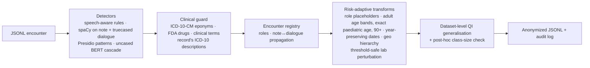

# MedAnon — context-aware anonymization of doctor–patient encounters

**Neural Wave Hackathon 2026 · Bosch challenge "Anonymization of patient data"**

> Team: _TODO — add every member's full name and role (required by the submission guidelines)._

MedAnon removes or generalizes privacy-relevant information in the `dialogue` and `note` fields of
the Bosch JSONL encounters while leaving clinical content — and `icd10_codes` — untouched. It runs
fully on-premise on a CPU (no GPU, no network at inference) at ~1.3 s per encounter, writes a
machine-readable explanation for every decision and a manifest that pins exactly which code, config
and model weights produced the output.

**At a glance.** These are local proxies, *not* official Bosch scores; see [Results](#results).
Eval split, 67 encounters:
- 0/62 patient-name seeds leaked
- ICD-10 description terms 100 % kept
- ICD-10 proxy-coder F1 unchanged (Δ 0.000)
- negation cues 100 % kept
- correct unique re-identification in a linkage attack 58 % → 3 %

Synthetic and injected tests:
- 100 % of 2,312 canary identifiers injected into real development encounters removed
- held-out adversarial synthetic set: recall 0.786 (95 % CI 0.755–0.815), precision 0.938

All 1,242 decisions have an explanation.



## Why this design

The data are ACI-Bench-style encounters: the **dialogue is lowercase ASR text** (`[doctor] hi , mr.
kowalczyk ...`) where capitalization-based NER fails, while the **note is cased**. Generic PII tools
also confuse medical eponyms and drug brands with people (`Parkinson's disease`, `Bell's palsy`,
`Lasix`, `Allegra`). MedAnon is therefore built around five ideas:

1. **Encounter-level reasoning.** A person, place or organization found in one field is searched
   for in the other (case-insensitively, with ambiguity gating). Names are found reliably in the
   cased note and *propagated* into the lowercase dialogue; every mention of the same person gets
   the same role placeholder (`[PATIENT_NAME]`, `[CLINICIAN_NAME]`, `[RELATIVE_NAME]`, `[PET_NAME]`).
2. **Detectors designed for lowercase speech.** Context patterns (titles, vocatives, "my wife , X",
   dictation openers "X , date of birth ..."), spoken numbers ("sixty two year old", "eight point
   three"), glued/spelled record numbers, and a *name-dominance ratio* computed from US Census/SSA
   name frequencies vs. English word frequencies (so "rosalind" counts as a name, "will"/"hope" do not
   without context). spaCy runs on a **note-guided truecased view** of the dialogue.
3. **A clinical-context guard.** Every PERSON/ORG/LOCATION candidate is checked against an
   ICD-10-CM-derived eponym list (with the head nouns that make them medical: *disease, palsy,
   cyst...*), a cleaned FDA drug lexicon, curated clinical abbreviations, and the record's own ICD-10
   descriptions. `Mr. Parkinson` is anonymized; `Parkinson's disease` is kept.
4. **Risk-adaptive transformations instead of blanket deletion.** Names → role placeholders; IDs,
   contacts, addresses → placeholders; dates and DOB → day and month removed, calendar year kept
   (`[DOB] 1985`, `[DATE] 2018`), except that a birth year is removed when the patient is 90 or older;
   calendar years in the clinical history are kept; ages → exact from 0 to 89, `90+` for 90 or more
   (HIPAA Safe Harbor; see "Retention policy" below); occupations → category (`[OCCUPATION: transport]`);
   countries → world region (travel history stays usable); lab values → a perturbation of at most
   3 % that **never crosses a clinical decision threshold** (HbA1c 8.3 → 8.2, still "8–9 %"),
   keyed by a secret so it cannot be recomputed from published data, applied consistently in note
   and dialogue, digits and spoken words. Values that cannot move within 3 % at their precision,
   and values inside reported ranges, are kept.
5. **Dataset-level quasi-identifier step.** After per-record anonymization, records whose published
   demographic quasi-identifiers are shared by fewer than *k*=3 records get occupation and ethnicity
   suppressed. With the default exact-age policy the age is **never** widened or suppressed by this
   step, so most records stay unique on (age, sex); the post-hoc check reports this honestly
   (`records_below_k` in the manifest). This is **not** k-anonymity, and the retained ages and years are
   a deliberate disclosure, not a detection failure. The former behaviour (age bands, then coarse
   groups, then suppression) is still available with `AGE: {action: generalize}`.

## Installation

Python 3.10–3.12, ~4 GB disk (packages + model weights). CPU works; a CUDA GPU is optional (peak 2.6 GB VRAM).

```bash
python -m venv .venv
# Windows: .venv\Scripts\activate      Linux/macOS: source .venv/bin/activate
pip install -r requirements.txt          # medanon, spaCy + en_core_web_lg, CPU torch, transformers
# GPU (optional): replace torch with a CUDA build, e.g. pip install torch --index-url https://download.pytorch.org/whl/cu124
medanon prepare-models                   # one-time download of the BERT + OpenMed NER weights (network needed once)
```

Release verification (18 Oct 2026): clean venv from `git archive`, `pip install -r requirements.txt` (resolved torch
2.14.1+cpu, transformers 5.20.1, spaCy 3.8.16), then `medanon anonymize --offline` with no `--config`: OK. The GPU
measurements in `reports/FINAL_HARDENING.md` used the development stack (`--device cuda`).

If `prepare-models` was skipped, the first `anonymize` run downloads the weights once. With
`--offline` any download is forbidden. After that nothing touches the network: Hugging Face loads
from the local cache, the spaCy model is a local package, and Presidio uses its bundled
public-suffix list. This was verified from a clean checkout in a new venv, with the network blocked
by a dead proxy.

**The configured model is required.** If it cannot be loaded, the run stops with instructions; it
never silently runs a different pipeline. Every run writes `<output>.manifest.json` recording:
- code and config SHA-256, and library versions
- model revision and weights SHA-256, and effective detector status
- input and output hashes and record counts

| Profile | Detectors | CPU s/encounter | RAM |
|---|---|---|---|
| `configs/default.yaml` (built-in default = release profile = `age_bands.yaml` policy) | rules + spaCy + uncased BERT cascade on the dialogue + OpenMed PII SuperClinical over all text; lab values → category intervals | ~13–17 | 3 GB |
| `configs/standard.yaml` (default until 2026-10-17) | rules + spaCy + uncased BERT cascade; bounded lab perturbation | ~1.3 | 1.6 GB |
| `configs/fast.yaml` (`--no-ml`) | rules + spaCy | ~0.4 | 1.2 GB |

The default (maximum privacy) is backed by `MODEL_EXPERIMENTS.md`: compared with `standard`,
held-out synthetic recall 0.786 → 0.886 and tolerant lab linkage 70.6 % → 11.8 %. `medanon
prepare-models` caches both the BERT and the OpenMed weights.

Lab-perturbation reproducibility: by default the key is random per run. Set
`MEDANON_SECRET=<private value>` to reproduce a run byte-for-byte, and never publish that value.

## Usage

```bash
# anonymize the evaluation split (the deliverable). The built-in default IS the release profile (adult ages in
# decade bands, exact paediatric ages, 90+, adult birth years removed); --config configs/age_bands.yaml is identical.
# Use --device cpu without a GPU. Legacy exact-age policy (0-89): --config configs/exact_age.yaml
medanon anonymize --offline --device cuda \
                  -i data/eval_patient_doctor_encounters.jsonl \
                  -o outputs/eval_patient_doctor_encounters.anonymized.jsonl
# -> also writes <output>.audit.jsonl (one explanation per decision, no original text)
#    and <output>.manifest.json (code/config/model hashes, effective detectors, timings)
medanon validate --original data/eval_patient_doctor_encounters.jsonl \
                 --anonymized outputs/eval_patient_doctor_encounters.anonymized.jsonl

# options
#   --config configs/standard.yaml      profile / per-category policies (placeholder|generalize|perturb|keep|redact)
#   --offline                           forbid any download (fails if weights are missing)
#   --no-ml                             fast profile (rules + spaCy)
#   --no-icd                            do not use ICD-10 descriptions as context (bonus setting)
#   --no-k-anonymity                    per-record streaming (constant memory, no dataset-level step)
#   --workers 4                         parallel detection (peak RAM in the manifest includes workers)
#   --audit-include-text                add original surfaces to the audit (sensitive, local review only)

medanon demo                          # synthetic example: before / after / explanations
pytest -q                             # 99 tests, synthetic data only
python scripts/run_experiments.py     # every number in the Results table -> outputs/results.json
python scripts/model_experiments.py   # model comparison (MODEL_EXPERIMENTS.md)
python scripts/annotation.py export   # blind Label Studio tasks for human annotation of 25 dev encounters
python scripts/privacy_check_docs.py  # before every push: docs, code and commit messages vs. real name seeds (masked)
```

Python API:

```python
from medanon import Anonymizer
anon = Anonymizer()                                  # or Anonymizer(config_path="configs/fast.yaml")
record_out, decisions = anon.anonymize(record)       # one encounter
results, stats = anon.anonymize_dataset(records)     # + dataset-level QI generalisation and check
```

## Output format

Identical JSONL schema, record order and key order; only `dialogue` and `note` change, and line breaks
and speaker tags are preserved. `encounter_id`, `dataset` and `icd10_codes` (code and description) are
byte-identical. Example (synthetic):

```
[doctor] hi , mr. kowalski , how are you ?          ->  [doctor] hi , [PATIENT_NAME] , how are you ?
my wife , jenny , drove me in from springfield .    ->  my wife , [RELATIVE_NAME] , drove me in from [LOCATION] .
you're a 67-year-old with parkinson's disease .     ->  you're a 67-year-old with parkinson's disease .  (ages 0-89 kept)
she is a 93-year-old woman , dob 02/11/1931 .        ->  she is a 90+-year-old woman , dob [DOB] .
surgery in 2018 with dr . kowalczyk , dob 3/22/1985 . ->  surgery in 2018 with [CLINICIAN_NAME] , dob [DOB] 1985 .
your a1c was eight point three                      ->  your a1c was eight point two   (note: 8.3% -> 8.2%)
i work as a truck driver at walmart                 ->  i work as a [OCCUPATION: transport] at [EMPLOYER]
my mrn is four five six seven eight nine            ->  my mrn is [ID]
He traveled to Brazil last month.                   ->  He traveled to [LOCATION: South America] last month.
```

Each audit line records:
- field and character offsets;
- category and action (`pseudonymize`, `generalize`, `perturb`, `keep`);
- replacement, risk class, contributing detectors and confidence;
- an explanation.

Kept medical look-alikes are logged too, with a `reason_code`: `EPONYM_IN_MEDICAL_USE`,
`DRUG_OR_CLINICAL_TERM`, `SECTION_HEADER`, … The audit never contains original text: words of the
judged span are scrubbed from explanations as `<span>`. The only exception is
`--audit-include-text`.

## Data handling

* Source datasets are never modified. `data/*.jsonl`, `outputs/` (including deliverables, audits and
  review files) and caches are git-ignored.
* The pipeline sends no text anywhere, and debugging used synthetic encounters. Diagnostics are
  aggregate and print only common words, medical terms or shapes. Twice a surname that is also a
  medical word slipped through and reached the docs. That is why `scripts/privacy_check_docs.py`
  exists: it compares docs, code and commit messages with name seeds from the local data, prints
  masked context only, and must report `FAIL 0` before every push.
* Inference is offline. This was verified from a clean checkout and a new venv with the network
  blocked.

## Repository layout

```
src/medanon/
  pipeline.py      orchestration: detect -> guard -> registry/propagation -> resolve -> transform -> QI step
  rules.py         lowercase-aware rules: ages, dates/DOB, (spoken) IDs, names in context, places, orgs, jobs, labs
  ner.py           spaCy+Presidio (truecased dialogue view), transformer detectors, model resolution
  llm.py           local LLM (Qwen3.5-2B GGUF) structured detector - experimental, not in the default
  medical.py       clinical-context guard (eponyms, drugs, abbreviations, morphology, record ICD-10 context)
  entities.py      person registry: roles, ambiguity-safe clustering, cross-field propagation
  transform.py     placeholders, exact age / 90+, year-preserving dates, geo hierarchy, lab intervals / perturbation
  manifest.py      run manifest + peak-memory sampler
  lexicon.py       offline lexicons, name-dominance ratio, number words
  resources/       compiled public-domain lexicons (Census, SSA, FDA NDC, ICD-10-CM, wordfreq)
  evaluation/      synthetic + adversarial gold sets, scoring with CIs, canaries, metrics, attacks
scripts/           run_experiments.py, model_experiments.py, annotation.py, privacy_check_docs.py, compare_detectors.py, build_resources.py
configs/           default.yaml (= max_privacy.yaml), standard.yaml, fast.yaml, validation_subset.json (ids only)
tests/             99 unit / end-to-end / review-regression / clinical-boundary tests (synthetic)
```

## Results

There are no gold annotations, so every number is a **local proxy**. Definitions are in
`src/medanon/evaluation/`; the run is `python scripts/run_experiments.py`. The table was measured
with `configs/standard.yaml` (the default until 2026-10-17); for the current default the measured
differences are held-out recall 0.886 and tolerant lab linkage 11.8 % (`MODEL_EXPERIMENTS.md`).
The eval split was never used for tuning.

| Dimension | Proxy | Result |
|---|---|---|
| Privacy | Patient-name seeds (after Mr./Ms./Dr., subjects of "X is a N-year-old") still present anywhere in the output | **0 / 62** eval · 1 / 120 dev |
| Privacy | Held-out **adversarial** synthetic set: 40 encounters, 720 identifiers, disjoint lexicons/phrasings (OOV and diacritic names, drug-named persons, spoken digits, long turns, rare jobs) | recall **0.786** (95 % CI 0.755–0.815), precision 0.938 |
| Privacy | Canary injection: 2,312 synthetic identifiers in real dev encounters | **99.96 %** removed (persons 99.9 %) |
| Privacy | Independent vanilla-Presidio audit; dates count only with a calendar anchor | 87.1 % eval · 87.9 % dev. Many survivors are reference false positives, but this is not gold-verified. |
| Utility | ICD-10 description words occurring in the text that survive | **100 %** (246/246) |
| Utility | ICD-10 coder (TF-IDF + LR, trained on dev), micro-F1 on eval | 0.384 → **0.384** (Δ 0.000). Low absolute value; only Δ matters. |
| Utility | Negation cues · numbers outside replaced spans | **1696/1696** kept · 0 changed |
| Utility | Clinical traps in the adversarial set (negation, dosage, labs, eponyms, temporal, diagnosis, family history) | 0.929. Family history 0.5: "when she was sixty" gets banded. |
| Utility | Lexicon concept recall (partly circular with the guard) | 99.4 % |
| Attack | Linkage, adversary knows exact age, sex, occupation, city: **correct** unique re-identification | **58.2 % → 3.0 %** (expected re-ID 0.71 → 0.10; wrong-unique 0 %) |
| Attack | Lab linkage, adversary knows exact values: correct unique links | exact match 76.5 % → 17.6 %; **3 %-tolerant 70.6 %** (perturbation only stops exact joins). With `max_privacy` (category intervals): 11.8 %. |
| Attack | Recomputing the perturbation from published seed + id (exact recovery) | public seed 42.9 % vs secret key 21.4 % (coincidental matches) |
| Attack | Residual-name harvesting | **0 %** of records |
| Re-identification | Records unique on published (age band, sex) · on the ICD-10 code set | **0 %** (was 40 %) · 97 % (inherent: codes must stay unchanged) |
| QI step | Smallest class over the declared QIs after generalisation (k = 3) | 3. No record below k; 9 of 67 records escalated. |
| Explainability | Decisions with an explanation | **100 %** (1,242 on eval) |
| Efficiency | Time per encounter / peak RAM / GPU (1 CPU process) | **1.3 s** / 1.6 GB / none; fast profile 0.4 s / 1.2 GB |
| Bonus: no ICD | `--no-icd` output identical to the ICD-aware output | 66 / 67 encounters |

**Detectors.** The uncased-BERT cascade was chosen over GLiNER-PII and GLiNER2-PII: same recall,
no precision loss, 2–4× cheaper. Plugged in naively, those models relabelled the `[doctor]` speaker
tags as occupations or persons. Newer candidates are covered in `MODEL_EXPERIMENTS.md`:
Healthcare-Brain-NER, Qwen3.5-2B as a structured-JSON detector, and OpenMed PII SuperClinical. Only
OpenMed significantly improves held-out recall (0.786 → 0.886). It costs ~12× CPU time and changed
2 spans in 25 real encounters. Since 2026-10-17 it is part of the default; `configs/standard.yaml`
is the 12× faster alternative.

## Limitations

* **Retention policy (release default since 2026-10-18).** Detection stays maximal. Published on purpose:
  * adult ages as decade bands (`[40-49]`), exact paediatric ages (0–17), 90+ aggregated;
  * the year of clinical dates (`[DATE] 2021`) and children's birth years (adult birth years are removed);
  * calendar years in the clinical history, and the ICD-10 codes (task requirement).

  Hardening results and remaining limits: `reports/FINAL_HARDENING.md`. The paragraph below describes the
  previous exact-age default (`configs/exact_age.yaml`), kept for reference.

  Exact ages raise re-identification risk, especially combined with sex and the unchanged ICD-10 codes:
  measured on the published output of the 140 dev encounters, records unique on (age, sex) rise from 2 (former age bands plus QI escalation) to 46, and records below k=3 on the declared QIs from 1 to 79; with the ICD-10 code set added, 136 instead of 132 are unique, because the codes alone already make almost every record unique. Privacy figures are therefore reported twice:
  * raw recall: the historical definition, where a retained entity counts as not removed;
  * policy-compliant recall: retained entities counted separately as deliberate disclosures, never as
    detection successes.

* **No human-annotated real gold yet.** All scores are proxies, and synthetic sets are written by
  us. `scripts/annotation.py` prepares a blind local annotation of 25 dev encounters.
* **Held-out synthetic misses (`standard` profile):**
  * persons named like drugs with only an apposition cue ("celexa , my coworker , told me"): 0 %
  * ordinary-word employers without a work cue: 55 %
  * occupations without a cue ("i've been a forklift mechanic"): 18 %; 100 % with `max_privacy`
* **Kept on purpose** (switchable in `policies`): relative times and seasons, ethnicity (suppressed
  only by the QI step), vital signs.
* **Lab perturbation (default)** protects only against exact-value joins. Use
  `LAB_VALUE: {action: generalize}` against tolerant linkage.
* **ICD-10 codes make most encounters unique.** This is unavoidable when the codes must be preserved;
  the QI step does not cover diagnoses, dates or free text, so this is not formal k-anonymity.
* **Eponymous surnames:** for a patient called *Parkinson* with Parkinson's disease, the diagnosis
  keeps the word.
* **Scope:** English, Latin scripts only; name and place lexicons are US-centric.

## Using the one mid-term evaluation

Send the anonymized eval JSONL (manifest and SHA-256 next to it) **only after team approval**.
Interpreting the feedback:

* **Privacy weak:** make relative dates or ethnicity placeholders.
* **Medical weak:** use `configs/standard.yaml`, check `placeholder_format` and `LAB_VALUE: {action: keep}`.

## Credits

spaCy (MIT), Microsoft Presidio (MIT), `dslim/bert-base-NER-uncased` (MIT), GLiNER / GLiNER2,
OpenMed PII SuperClinical, Healthcare-Brain-NER and Qwen3.5 / unsloth GGUF (Apache-2.0), llama.cpp
(MIT) for the comparison studies. Lexicons are compiled from:
- US Census 2010 surnames and US Census 1990 first names;
- SSA baby names, via hadley/data-baby-names;
- FDA NDC product file;
- ICD-10-CM, via `simple-icd-10-cm`;
- `wordfreq`.

Data: Yuan, Moy et al., EMNLP 2025 Industry Track (ACI-Bench-derived encounters).
