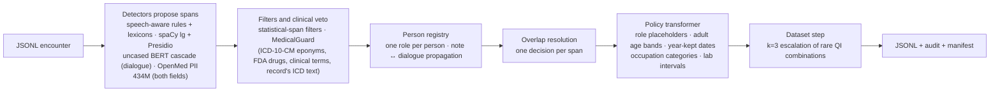

# MedAnon: context-aware anonymization of doctor–patient encounters

**Neural Wave Hackathon 2026 · Bosch challenge "Anonymization of patient data" · release `e6c3ce7`**

**Jury report (3 pages): [`report/JURY_REPORT.pdf`](report/JURY_REPORT.pdf)** (LaTeX source
[`report/jury_report.tex`](report/jury_report.tex), Markdown mirror [`report/JURY_REPORT.md`](report/JURY_REPORT.md)).

MedAnon removes or generalizes privacy-relevant information in the `dialogue` and `note` fields of the Bosch JSONL
encounters and leaves the clinical content, and `icd10_codes`, untouched. It runs on-premise and offline (CPU, or a
GPU within 4 GB of VRAM), explains every decision in an audit log, and writes a manifest that pins the code, config
and model weights behind each output.

## Quick start

```bash
pip install -r requirements.txt     # Python 3.10–3.12; installs the `medanon` command
medanon prepare-models              # once: downloads the NER weights (needs network)
medanon anonymize --offline --device cpu -i input.jsonl -o output.jsonl   # --device cuda on a GPU
medanon validate --original input.jsonl --anonymized output.jsonl         # checks IDs, order, ICD-10
```

No weights yet? `medanon demo --no-ml --offline` shows a fictional before/after in seconds. Details below.

## Results at a glance

Three kinds of evidence, never mixed. None of the local numbers is an official Bosch score or a real-world
re-identification probability; the final Bosch score is unknown.

| Evidence | Result | Source |
|---|---|---|
| Bosch mid-term feedback on an **earlier build** (before the hardening and the age-band default) | privacy removal proportion 0.5918 · ICD-10 F1 delta 0.0 · medical concept recall 1.0 | organizers' feedback; not a score of this release |
| Paired synthetic regression, baseline `ceff209` → hardened, same age-band policy (Synthea worlds dev1 / dev2 / long1) | blood pressure kept exactly 44/92 → 92/92, 48/91 → 91/91, 18/47 → 47/47; exact count of ≥ 3 children visible 20/61 → 0/61, 31/54 → 0/54, 12/16 → 0/16 | [`reports/FINAL_HARDENING.md`](reports/FINAL_HARDENING.md) §3 |
| Red-team probes (12 fictional encounters, 54 assertions) | privacy 7/12 → 12/12 · clinical 39/42 → 42/42 | [`tests/fixtures/redteam_handoff/`](tests/fixtures/redteam_handoff/), [`tests/test_hardening.py`](tests/test_hardening.py) |
| Synthetic linkage attack (Splink, threat C, pool 2,000, dev worlds, **not blind**) | correct re-identification 21.5 % → 11.7 % | [`reports/FINAL_HARDENING.md`](reports/FINAL_HARDENING.md) §3, [`research/reid/`](research/reid/) |
| Local proxies on the 67-record eval split (aggregates only) | validation 67/67 · ICD-10 proxy F1 Δ 0.0 · ICD description terms 246/246 · lexical concept recall 0.994 | [`reports/FINAL_HARDENING.md`](reports/FINAL_HARDENING.md) §3 |
| Engineering | 194 tests (194/194 on the GPU host) · peak VRAM 2,639 MiB · offline inference | [Tests](#tests), [Hardware](#hardware-and-speed) |

Clinical cost and residual risk are part of the result, not a footnote: lab values become clinical intervals, about
9–14 % of weights and heights needed exactly are still generalized on synthetic data, and an informed attacker
still re-identifies about 12 % of synthetic dev encounters. See [Limitations](#limitations).

**Bonus tasks from the challenge brief** (all five addressed; details in the report, §5):

- *Adversarial privacy attacks:* our Splink linkage benchmark with three threat models ([`research/reid/`](research/reid/))
  and a teammate's local LLM adversary ([`attack/`](attack/)). On the older build `ceff209` with age bands, the LLM
  recovered 7 of 98 masked identifiers on the eval split (7.1 %); names 2/69, at chance level.
- *Explainability:* every decision has an explanation in the audit log (989/989 on the final eval output).
- *Efficiency:* measured runtime, RAM and VRAM in [Hardware and speed](#hardware-and-speed); lighter profiles for CPU-only use.
- *Without ICD-10 codes:* `--no-icd`. On an earlier build (`standard` profile), 66/67 eval outputs were identical
  with and without the ICD context.
- *Robustness to other inputs:* synthetic Synthea worlds with long-form records and a blind world with an unseen
  population and phrasing.

## How it works



The data are ACI-Bench-style encounters: the dialogue is lowercase speech-recognition text, where capitalization-based
NER fails, and the note is cased. Generic PII tools also mistake eponyms and drug brands for people. MedAnon is built
around five ideas:

1. **Spans, not rewriting.** Detectors only propose character spans; a policy decides how each one is transformed.
   No generative model touches the text at inference, so nothing outside the replaced spans changes and nothing can be
   hallucinated.
2. **Encounter-level reasoning.** A person found in the cased note is propagated into the lowercase dialogue, and
   every mention of the same person gets the same role placeholder (`[PATIENT_NAME]`, `[CLINICIAN_NAME]`,
   `[RELATIVE_NAME]`).
3. **Detectors built for speech.** Context patterns (titles, vocatives, "my wife , X", dictation openers), spoken
   numbers, glued or spelled record numbers, and a name-dominance ratio computed from US Census/SSA name frequencies
   against English word frequencies. spaCy runs on a note-guided truecased view of the dialogue.
4. **A clinical veto.** Every person, organization or place candidate is checked against ICD-10-CM eponyms, an FDA
   drug lexicon, clinical terms and the record's own ICD-10 descriptions: `Mr. Parkinson` is anonymized,
   `Parkinson's disease` is kept.
5. **Generalize instead of delete.** Quasi-identifiers keep their clinical signal in a coarser form, then a dataset
   step generalizes any record whose (age band, sex, occupation category, ethnicity) combination is shared by fewer
   than three records. This is a heuristic, not formal k-anonymity.

**Release policy** (built-in default; identical to `configs/age_bands.yaml`):

| Information | Output |
|---|---|
| Names | consistent role placeholders across note and dialogue |
| Age | adult decade band `[40-49]`; exact under 18 (clinically needed); `90+` |
| Dates and birth dates | day and month removed, year kept (`[DATE] 2024`); adult birth years removed |
| Places, organizations | `[CITY]`, `[US_STATE]`, `[EMPLOYER]`, `[SCHOOL]`, `[HEALTHCARE_FACILITY]`; countries become a world region |
| Occupation | category, e.g. `[OCCUPATION: service]` |
| Lab values, body measures | clinical interval (A1c 8.0 → `[8-9]`); weight and height generalized unless needed exactly (paediatrics, weight-based dosing) |
| Kept | diagnoses, drugs, doses, vital signs, durations, relative times; `icd10_codes` byte-identical |

The legacy exact-age policy (exact ages 0–89, `90+`) is still available with `--config configs/exact_age.yaml`.

## Installation

Python 3.10–3.12 (release verified on 3.12), about 4 GB of disk for packages and model weights. CPU works; a CUDA GPU
is optional.

```bash
python -m venv .venv
# Windows: .venv\Scripts\activate      Linux/macOS: source .venv/bin/activate
pip install -r requirements.txt          # medanon, spaCy + en_core_web_lg, CPU torch, transformers, Presidio
# GPU (optional): replace torch with a CUDA build, e.g. pip install torch --index-url https://download.pytorch.org/whl/cu124
medanon prepare-models                   # one-time download of the BERT and OpenMed weights (network needed once)
```

After `prepare-models`, nothing touches the network: Hugging Face loads from the local cache, the spaCy model is a
local package, and Presidio uses its bundled data. With `--offline` any download is forbidden. If a configured model
cannot be loaded, the run stops with instructions; it never silently runs a weaker pipeline. A clean install from
scratch (Python 3.12, fresh venv) and an offline run without `--config` were verified for the release.

## Usage

```bash
# Anonymize a JSONL file with the release policy (no --config needed). Use --device cuda on a GPU.
medanon anonymize --offline --device cpu \
                  -i data/eval_patient_doctor_encounters.jsonl \
                  -o outputs/eval_patient_doctor_encounters.anonymized.jsonl
# -> also writes <output>.audit.jsonl (one explanation per decision, no original text)
#    and <output>.manifest.json (code/config/model hashes, effective detectors, timings)

# Strict structural check: same IDs, order, keys and icd10_codes; only dialogue/note changed
medanon validate --original data/eval_patient_doctor_encounters.jsonl \
                 --anonymized outputs/eval_patient_doctor_encounters.anonymized.jsonl

medanon demo                                     # fictional encounter: before / after / explanations
medanon demo --no-ml --offline                   # same, reduced profile (rules + spaCy, no model weights needed)
```

Options: `--config <yaml>` (profile and per-category policies), `--offline`, `--device cpu|cuda|auto`, `--no-ml`
(reduced profile: rules + spaCy only), `--no-icd` (do not use ICD-10 descriptions as context), `--no-k-anonymity`
(per-record streaming without the dataset step), `--workers N` (parallel detection; RAM grows with workers),
`--audit-include-text` (adds original surfaces to the audit; sensitive, local review only).

| Profile | Detectors | Notes |
|---|---|---|
| built-in default (= `configs/default.yaml` = `configs/age_bands.yaml` policy) | rules + spaCy/Presidio + uncased BERT cascade (dialogue) + OpenMed PII (both fields) | release profile |
| `configs/exact_age.yaml` | same | legacy policy: exact ages 0–89 |
| `configs/standard.yaml` | rules + spaCy/Presidio + BERT cascade, no OpenMed | default until 2026-10-17; about 12× faster on CPU |
| `configs/fast.yaml` (`--no-ml`) | rules + spaCy/Presidio | reduced profile, no torch needed |
| `configs/age_bands_strict_dates.yaml` | same as default | experimental: also removes the year from full dates |

Python API:

```python
from medanon import Anonymizer
anon = Anonymizer()                                  # or Anonymizer(config_path="configs/fast.yaml")
record_out, decisions = anon.anonymize(record)       # one encounter
results, stats = anon.anonymize_dataset(records)     # + dataset-level QI step and check
```

## Output format

Same JSONL schema, record order and key order; only `dialogue` and `note` change, and line breaks and speaker tags
are preserved. `encounter_id`, `dataset` and `icd10_codes` are byte-identical. Example from `medanon demo`
(fictional encounter):

```
[doctor] hey dragon , i'm seeing ray cushing today .  ->  [doctor] hey dragon , i'm seeing [PATIENT_NAME] today .
he is a 46-year-old male with cushing's syndrome .    ->  he is a [40-49]-year-old male with cushing's syndrome .
i work as a cashier at boeing                         ->  i work as a [OCCUPATION: service] at [EMPLOYER]
my daughter , keisha , has been helping me            ->  my daughter , [RELATIVE_NAME] , has been helping me
i grew up in texas but we moved to boise last year    ->  i grew up in [US_STATE] but we moved to [CITY] last year
your a1c came back at eight point zero                ->  your a1c came back at [8-9]
Follow up with Dr. Mcallister at Good Samaritan Hospital on June 25, 2024.
                                                      ->  Follow up with [CLINICIAN_NAME] at [HEALTHCARE_FACILITY] on [DATE] 2024.
```

Each audit line records the field and character offsets, category and action, replacement, contributing detectors,
confidence and an explanation. Kept medical look-alikes are logged too, with a `reason_code`
(`EPONYM_IN_MEDICAL_USE`, `DRUG_OR_CLINICAL_TERM`, `SECTION_HEADER`, …). The audit never contains original text
unless `--audit-include-text` is set. The manifest records code and config SHA-256, library versions, model revisions
and weight hashes, effective detector status, input/output hashes and record counts, and the dataset QI check
(`records_below_k`).

For the final eval output of the release (67 records, CPU, offline, default config): 67/67 records pass
`medanon validate` with identical IDs, order, fields and ICD-10 codes; 989 decisions, all explained; output SHA-256
`248a3d0f…`; the QI check reports 5/67 records below k = 3. The file itself is confidential and not in this repository.

## Hardware and speed

| Measurement (default profile) | Value |
|---|---|
| Peak GPU memory (nvidia-smi, includes CUDA context) | **2,639 MiB**, measured on a 48 GB card; a physical 4 GB card was not tested |
| Peak process RAM | 3.64 GB |
| GPU time per record, including model load | 0.26 s (Synthea worlds), 0.79 s (long records) |
| CPU time per record | about 13.7 s (67-record eval run) |

## Tests

```bash
pip install -r requirements-dev.txt
pytest -q          # 194 tests, synthetic data only
```

The suite covers units, end-to-end runs, clinical boundaries, review regressions and the 12 red-team probes. Tests
that need the transformer detectors require the weights from `medanon prepare-models`. 194/194 passed on the GPU host
with the production detectors on the release code.

## Evaluation and evidence

- [`reports/FINAL_HARDENING.md`](reports/FINAL_HARDENING.md): paired before/after on fictional data, red-team
  regression, eval proxies, VRAM. Its §9–§10 predate commit `e276bd0`: the built-in default **is** now the age-band
  policy.
- [`research/reid/`](research/reid/): our synthetic re-identification benchmark (Synthea population, auxiliary
  registries, Splink attacker, threat models A/B/C, dev worlds and one blind world). Its "default" column is the old
  exact-age policy of build `ceff209`.
- [`attack/`](attack/) and [`attack/ATTACK_SPEC.md`](attack/ATTACK_SPEC.md): a teammate's independent LLM-based attacker and
  deterministic mask audit, with an evaluation of the older build `ceff209` in
  [`attack/paper/EVAL_REPORT.md`](attack/paper/EVAL_REPORT.md).
- Gold-based scoring on synthetic rounds: `scripts/score_gold.py`; local proxies: `medanon evaluate`,
  `scripts/run_experiments.py`; model comparison: `scripts/model_experiments.py`.

The attackers model different threats; their numbers are reported side by side, never added together.

## Limitations

- **Ambiguous surnames.** Surnames that are also common words can survive a partial match (about 1–2 % of name
  mentions on synthetic data).
- **Places without a cue.** Towns mentioned without a residence cue can survive.
- **The clinical story is kept on purpose.** ICD-10 codes (a task requirement), event years and the visit year are
  linkage vectors; an attacker who already knows part of the history still re-identifies about 12 % of synthetic dev
  encounters (pool 2,000).
- **Children.** Exact paediatric ages and children's birth years are kept because they matter clinically.
- **Clinical cost.** Lab values become clinical intervals (`EF [40-50]` straddles the HFrEF/HFmrEF cut-off); about
  9–14 % of weights and heights needed exactly are still generalized, because the exemptions are rules.
- **Not formal k-anonymity.** The dataset step covers four quasi-identifier types; free text, dates, diagnoses and
  lab values are not covered.
- **Validation gaps.** No blind validation of the final release, no human-annotated real gold, English-only and
  US-centric lexicons.

## Data handling

- Source datasets are never modified. `data/*.jsonl`, `outputs/` and caches are git-ignored; no patient data,
  anonymized outputs or private gold belong in this repository.
- The pipeline sends no text anywhere, and all debugging used fictional encounters.
- The anonymized evaluation file required by the task is delivered separately; it is not stored here.
- `scripts/privacy_check_docs.py` compares docs, code and commit messages with name seeds from the local data,
  prints masked context only, and must report `FAIL 0` before every push.
- The git history of this repository predates some of these rules: publish a clean snapshot, not the history.

## Repository map

```
src/medanon/          production pipeline (frozen release)
  pipeline.py           orchestration: detect -> filters/guard -> registry -> resolve -> transform -> dataset step
  rules.py              lowercase-aware rules: ages, dates/DOB, spoken IDs, names in context, places, orgs, jobs, labs
  ner.py                spaCy + Presidio (truecased dialogue view), transformer detectors, model resolution
  medical.py            MedicalGuard: eponyms, drugs, abbreviations, record ICD-10 context
  entities.py           person registry: roles, ambiguity-safe clustering, cross-field propagation
  transform.py          policy transformer: placeholders, age bands, year-preserving dates, categories, intervals
  quasi.py, spans.py    quasi-identifier detection, span overlap resolution
  manifest.py, cli.py   run manifest and peak-memory sampler; command line
  llm.py                experimental local-LLM detector (not used by any release profile)
  resources/            compiled public lexicons (see THIRD_PARTY_NOTICES)
  evaluation/           synthetic gold sets, scoring, canaries, proxies, attacks
configs/              release default (default.yaml = age_bands.yaml), exact_age, standard, fast, strict-dates
tests/                194 tests on synthetic data, incl. fixtures/redteam_handoff (12 fictional probes)
scripts/              experiments, gold scoring, detector comparison, lexicon build, privacy gate
report/               jury report: LaTeX source, PDF, Markdown mirror
docs/                 submission checklist, video script and storyboard, history/ (older reports, dossiers)
research/reid/        synthetic re-identification benchmark (research, not part of the product)
attack/               independent attacker and mask audit (research; spec in attack/ATTACK_SPEC.md)
reports/              FINAL_HARDENING.md (primary technical source), round reports (historical)
task/                 public Bosch task description
```

Historical documents are in [`docs/history/`](docs/history/), kept for traceability and partly outdated: the old
report, the model experiments (OpenMed was opt-in then; it is the default now), the codebase walkthrough, the
overview image and the Italian dossiers (`MEDANON_DOSSIER_TOTALE_2026-10-18.txt` is the most current). Round
reports are in `reports/`.

## Team

- Matteo Marello (matteomarello3@gmail.com)
- Paolo Pusterla (pusterlapaolo81@gmail.com)
- Tommaso Riggio (tommy.riggio204@gmail.com)
- Andrea Orione (andrea.orione02@gmail.com)
- Valeria Intini (valeriaintini2001@gmail.com)

## AI tools disclosure

We used Claude (Anthropic, through Claude Code) and other AI coding assistants extensively for implementation, tests,
analysis and documentation, including this README and the jury report. Their output was checked by the automated
tests, controlled synthetic benchmarks with fixed denominators, and human review. The anonymizer itself uses no
generative model; a local LLM is used only by the teammate's attacker in `attack/`.

## Licence and credits

MedAnon is released under the [MIT licence](LICENSE). Third-party software, models and data keep their own licences,
listed in [`THIRD_PARTY_NOTICES.md`](THIRD_PARTY_NOTICES.md); in particular, `src/medanon/resources/common_words.tsv`
is derived from wordfreq data under CC BY-SA 4.0.

Data: Yuan, Moy et al., "Toward reliable clinical coding with language models: verification and lightweight
adaptation", EMNLP 2025 Industry Track (ACI-Bench-derived encounters), provided by Bosch for the challenge; not
included here.
