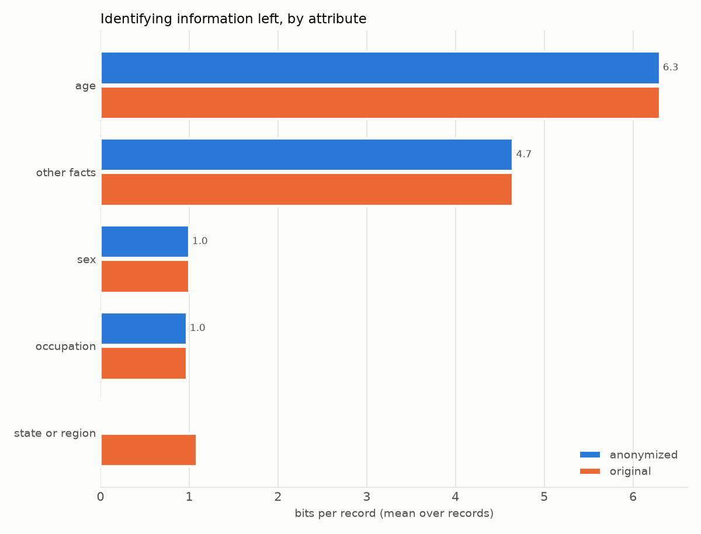
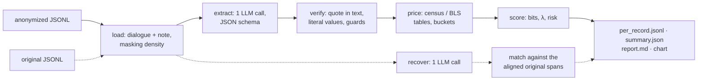

# Re-identification attack: status report

> Privacy note (2026-10-18): real encounter IDs are replaced by neutral labels (R1–R10, T1–T3), and record-specific names, places and verbatim quotes by paraphrases. Per-record files keyed by real IDs stay local.

*2026-10-18 · branch `adversary-reidentification` (nothing committed) · attacker `qwen3.5:35b` (Q4_K_M,
Ollama, one RTX 4090 48 GB) · prompts `extract-v4` / `recover-v3` · spec: [`ATTACK_SPEC.md`](ATTACK_SPEC.md)
· usage: [`README.md`](README.md)*

## Summary

The attack is complete and was tuned against a human review of 5 real anonymized evaluation records
(R1–R5): 0 failed records, no sanity warnings, 88 tests passing, lint clean. After tuning, the
attack's bit estimates are within 2.0 bits of the human estimates on average (3.2 before), and the attack
ranks the records the way the reviewer does. With the GPU host otherwise idle, attacking one
anonymized record takes about 8 s. The full-dataset runs were stopped on request; every number below covers
five records.

| | status |
|---|---|
| Spec steps 0–8 | ✅ implemented |
| Tests / lint | ✅ 88 passed · `ruff check attack` clean ([`ruff.toml`](ruff.toml)) |
| Real 5-record run (eval R1–R5) | ✅ 0 failures, no warnings, checked against a human ground truth |
| Time per anonymized record (GPU host idle) | ✅ ≈ 8 s (extraction ≈ 4 s + recovery ≈ 3.5 s) |
| Spec's expected findings | ⚠️ 1 of 6 checked on real output (R1); the others are in records never run |
| Full eval set / train set through MedAnon | ⛔ stopped on request (see Performance: ~15–30 min on an idle host) |

## Results on the five validation records (current prompts)

| metric | anonymized | original |
|---|---|---|
| mean risk (P(attacker picks the right person); lower = better) | 2.97e-04 | 1.19e-02 |
| mean / median / p90 bits | 12.9 / 14.0 / 16.9 | 14.0 / 14.0 / 20.2 |
| likely unique (λ < 1, i.e. more than 28.3 bits) | 0 % | 0 % |
| quote not found in the text ("hallucination rate") | 10.7 % | 13.8 % |

**Privacy gain** 97.5 % · **bits removed** 1.1 per record · **recovery** 1 of 2 scorable non-name
guesses (the state); 0 of 5 names



| record | anonymized bits (look-alikes λ) | what the attack scores |
|---|---|---|
| R1 | 18.8 (≈ 700) | age 50 · female · works as a data analyst · hikes near a named landmark. The original also gives the state (5.4 bits), which the pipeline masked |
| R3 | 14.0 (≈ 21,000) | age 61 · male · apartment up three flights of stairs |
| R5 | 14.0 (≈ 20,000) | age 41 · female · details of a car accident beyond its ICD code (four-way stop) |
| R2 | 10.6 (≈ 210,000) | age 62 · male · house with basement stairs |
| R4 | 7.2 (≈ 2.2 million) | age 57 · male (golf is in the ICD codes, so it counts as floor) |

The only difference between the anonymized and the original records is R1's masked state (5.4 bits,
i.e. 1.1 bits per record). Mean risk is an average of probabilities, so it is dominated by one record:
the original R1 makes up 96 % of the original's mean risk. Across five records, "97.5 % gain" says
that R1 got safer, not that the pipeline as a whole is 97.5 % effective.

## Human review: the five records read by hand as ground truth

I read all five anonymized records end to end, listed every non-medical fact that would help find the
patient, priced each one from population figures, and compared the result with the attack's output.

### Ground truth vs the attack, in bits

| record | identifying facts a human finds (≈ bits) | human | before tuning | v3 | **v4 (current)** |
|---|---|---|---|---|---|
| R1 | age 50 (6.3) · female (1) · weekend hike near a named landmark, i.e. tied to one state (≈5.4) · pulls fiscal-year-end data for long hours, an office/finance job (≈3.9) · hikes a lot (≈2.5) | ≈ 19 | 17.3 | 27.2 | **18.8** |
| R2 | age 62 · male · house with a basement (≈1 in 3 homes, ≈1.3) | ≈ 8.6 | 14.0 | 10.6 | **10.6** |
| R3 | age 61 · male · third-floor walk-up apartment (≈4.3) · takes the bus (≈4.3; correlated with the apartment) | ≈ 15 | 17.3 | 17.3 | **14.0** |
| R4 | age 57 · male · loves jelly beans (≈1.7); golf is in the ICD codes (`Y93.53 Activity, golf`) | ≈ 9 | 13.9 | 7.2 | **7.2** |
| R5 | age 41 · female · accident details beyond the ICD code `V89.2` (motor-vehicle accident): four-way stop, texting driver (≈2) | ≈ 9 | 10.7 | 17.3 | **14.0** |
| **mean absolute error** | | | 3.2 | 4.5 | **2.0** |
| **mean signed error** | | | +2.5 | +3.4 | **+0.8** |

### Strengths

- **Precision.** Every fact the attack counted is true and about the patient: no misattribution to the
  clinician, no invented facts surviving verification. The verifier dropped every invented fact,
  including facts copied from the few-shot examples ("lives alone", "near Lake Tahoe").
- **The core quasi-identifiers are always found:** exact age and sex in 5/5 records, priced from the
  census table.
- **Recovery found the one recoverable value:** `[US_STATE]` → the correct state from a named landmark left
  in the text (high confidence), as the spec predicted. Names had no clues and were all missed (0/5), as
  expected.
- **Cost:** about 8 s per anonymized record with the host idle.

### Weaknesses found, and what was done

| weakness (before tuning) | evidence | change | effect |
|---|---|---|---|
| Rarity over-estimated: every listed fact costs at least 3.3 bits, even trivial ones | basement priced 1 in 100 (6.6 bits, human ≈1.3); jelly beans 3.3 | prompt: skip facts shared by more than ~1 in 10 people; rarity examples for each life area | basement 6.6 → 3.3; jelly beans gone |
| Events under-described | R5's accident extracted as "drives a car with a trunk that crumpled" | prompt: describe events as events | now "rear-ended at a four-way stop" |
| Facts the ICD codes already state counted as leaks | golf (`Y93.53`), car accident (`V89.2`) | `icd_floor`: shared word or synonym with an external-cause/activity code (V–Y) | golf and the accident are now floor |
| Job clues without a job title missed | R1 "fiscal year end data … long hours" | prompt: check work, housing, transport, hobbies, travel and events in turn | found ("data analyst", 4.9 bits) |
| Quotes joined with "..." rejected as hallucinations | "a sweet tooth ... i love jelly beans" | each fragment is verified on its own | fewer false "hallucinations" |
| Region placeholders unmatched | `[LOCATION]` = "cascades" could never match "North Cascades" | non-state regions matched by `token_set_ratio ≥ 85` | scorable |
| Name guesses dilute the recovery rate | 0/5 names, no clues in the text | `recovery.excluding_names` reported next to the overall rate | 50 % excluding names vs 14 % overall |

**A tuning step that backfired, kept here as a lesson.** In v3 the rarity scale used one example for
everything ("rear-ended at a four-way stop last week" = rare), and the model then rated R1's weekend
trip as rare (10 bits): R1 jumped to 27.2 bits and the mean error rose to 4.5. v4 gives separate
examples for each life area (a trip to a state is common, a named landmark uncommon), and the error fell
to 2.0.

### What remains imperfect

- **Recall wobbles between versions:** "takes the bus" (R3) was found by v2 and lost by v4. One
  extraction per record is noisy. With `--original`, the two-sided union compensates; without it, the
  anonymized risk can miss a fact.
- **Residual details stay over-priced:** the accident detail in R5 counts 6.6 bits, against ≈2 in the human estimate.
- **Paraphrased quotes:** 10.7 % of extracted facts have quotes that are not verbatim (mostly trivial facts
  spread over two sentences, plus facts copied from the few-shot examples). They are dropped correctly,
  but they inflate the "hallucination rate", which here mostly measures quote fidelity.
- **Small sample.** These are one reviewer's estimates on five records. The direction of the errors is
  clear; their size is not.

### What the review says about the anonymization pipeline

1. **Exact age is the largest quasi-identifier left** (6.3 bits in every record). Five-year bands would
   remove about 2.3 bits per record; ten-year bands about 3.4.
2. **Landmarks give away masked places:** a named landmark next to `[US_STATE]` (recovered).
3. **Over-masking:** "COVID 19" (R1) and "lungs" (R3) were replaced by `[PERSON]`. This costs utility, not privacy.
4. **Lifestyle details survive** (stairs, basement, hobbies). They are individually common and useful
   clinically, so they are better left alone.

## Performance

All measurements are on the same host (`qwen3.5:35b`, RTX 4090), with the CPUs either idle or saturated by MedAnon.

| measurement | host idle | MedAnon running |
|---|---|---|
| one extraction (4.7k-token prompt, ~600 output tokens) | **3.7 s** (168 tokens/s) | 33 s (20–23 tokens/s) |
| one recovery (~500 output tokens) | **3.4 s** | 9 s |
| attack on one anonymized record (extraction + recovery) | **≈ 7–8 s** | ≈ 42 s |
| … with `--original` (+ one extraction of the original) | ≈ 11–12 s | ≈ 75 s |
| batch of 15 calls, 4 workers | 58 s | — |
| thinking mode on, same extraction | 281 s / 5,477 tokens | |

The 5–9× slowdown came entirely from MedAnon saturating the CPUs (load average 109–124 on 16 cores, GPU
0–11 % busy): Ollama's JSON-schema decoding needs CPU time per token. On an idle host the full eval set
(201 calls) would take about 13 min and the train set (420 calls) about 27 min. Ollama's 4 parallel slots
barely helped (15 calls in 58 s ≈ 3.9 s per call vs 3.7 s alone), so more GPUs or a faster serving stack
would cut this further.

**Time-budget decisions:**

- **Kept:** one extraction call per record (as in the spec). The v4 prompt is about 10 % longer, which is
  negligible because Ollama caches the shared prefix (prefill takes 0.1 s).
- **Not adopted by default:** a second extraction sample per record, with a different seed, merged as a
  union. It would stabilize recall ("takes the bus") for about +4 s per record (+50 %). Worth adding as
  an option if recall matters more than following the spec.
- **Rejected:** a larger dense model. It would cost roughly 10× the time; the errors found here come from
  prompt calibration, not from model capacity.

## How the attack works



Dashed paths run only with `--original`. The attack never imports the pipeline; it reads only the JSONL
files.

| module | lines | role |
|---|---|---|
| [`run.py`](run.py) | 161 | CLI; schedules every LLM call in one thread pool; scores both versions together |
| [`llm.py`](llm.py) | 179 | Ollama native / OpenAI-compatible client, disk cache, retries with a shifted seed, thinking off |
| [`extract.py`](extract.py) | 133 | pydantic schema, system prompt `extract-v4` (rarity examples per area), 3 few-shot examples |
| [`verify.py`](verify.py) | 137 | quote verification (fragment by fragment), literal values, guards: medical, names, relative dates, ICD floor |
| [`tables.py`](tables.py) | 290 | age (ACS 2020), state (Census 2020), occupation (BLS OEWS 2023), ethnicity, family, rarity |
| [`score.py`](score.py) | 163 | pricing, one value per category, duplicate facts, bits / λ / risk, aggregation |
| [`recover.py`](recover.py) | 170 | recovery prompt `recover-v3`, word alignment for ground truth, matching rules, rates without names |
| [`report.py`](report.py) | 146 | `report.md` and the chart |
| [`check_endpoint.py`](check_endpoint.py) | 149 | step 0: finds the API, lists models, sends one test reply |
| [`data.py`](data.py) | 36 | loading, placeholder regex, masking density, ICD descriptions |
| [`tests/`](tests/) | 423 | 88 tests: scoring, verification, guards, tables, alignment and matching, offline end to end |

## Where it departs from the spec, and why

| spec | implementation | reason |
|---|---|---|
| default model `qwen2.5:32b` | `qwen3.5:35b` | the only model pulled on the GPU host (the spec says to check `/api/tags`) |
| OpenAI `/v1/chat/completions`, falling back to `/api/chat` | native `/api/chat` by default; `--backend openai` still available | `/v1` cannot set the context size, and Ollama silently truncates prompts beyond its default |
| (not covered) | `think: false` for thinking models | 281 s → 3.7 s per extraction for the same JSON |
| recovery ground truth from extracting the original | word alignment gives the exact masked span; extraction only as a fallback | names are not in the extraction schema, and alignment is exact |
| quote check only (Step 3) | also literal values, fragment-wise quotes, medical / name / relative-date / ICD-floor guards, de-duplication | the real model breaks these prompt rules |
| ICD codes scored separately | facts that restate external-cause and activity codes (golf, a vehicle accident) are floor too | same reasoning as for diagnoses: the task keeps the codes |
| anonymized and original compared as extracted | each side also scored on the other side's facts that verify in its own text | otherwise extraction noise made up 71 % of `bits_removed` |
| one recovery rate | overall, plus one without names | names are unrecoverable without clues and hide what the context gives away |
| SSH tunnel to the API | repository synced to the GPU host and run there | as requested: no API exposed |

## Bugs found earlier in real-model validation

| found in | symptom | fix |
|---|---|---|
| 2-record smoke run | 75 s per call; Ollama served one request at a time | `think: false`; `OLLAMA_NUM_PARALLEL=4` |
| smoke run | state, name and diagnoses listed as `other_facts`; privacy gain −17,319 % | guards; a fact naming a state priced as that state; union of both extractions |
| first 5-record run | murmur, atrial fibrillation, mammogram scored; "full name Peter Lang" 13.3 bits; "last weekend" as a date; restated facts counted twice | medical list plus ICD fuzzy match; name hints; `not_absolute_date`; `same_fact` |
| first 5-record run | a filler name scored as recovering the first name; guesses for absent or out-of-scope placeholders; dictation-software names guessed as names | filler names count as wrong; `placeholder_not_in_text` / `out_of_scope`; recovery prompt v2 |
| report writing | 71 % of `bits_removed` was facts missed by one of the two extractions | symmetric union, verbatim from the original side |
| tooling | chat test returned `''` and reloaded the model | native API, same `num_ctx` |

## Spec's expected findings

| record | expected | status |
|---|---|---|
| R1 (recovery) | named landmark next to `[US_STATE]` → state | ✅ recovered, high confidence |
| R6 (recovery) | `[DOB] YYYY` + stated age → visit year | not run (age logic unit-tested) |
| R7 | an occupation term and an employer name survive | not run (alias and employer pricing unit-tested) |
| R8 | veteran with 1 % disability | not run |
| R9 | owns an auto repair shop | not run (business-owner pricing unit-tested) |
| R10 | ten siblings | not run ("ten of us" → 1e-3 unit-tested) |

## Current state

**Local** (branch `adversary-reidentification`, nothing committed): new `attack/` package (1,564
lines; tests 423 lines), `README.md`, `REPORT.md`, `ruff.toml`, `docs/validation5_top_leaking_attributes.png`
(aggregate chart, no record text). `.gitignore` adds `attack/cache/`, `attack/results/` and
`.ruff_cache/`. Ignored: `data/` and the validated run in
`attack/results/qwen3.5-35b_output_eval_patient_doctor_encounters_limit5/`.

**GPU host** (`root@104.63.172.143 -p 12621`): nothing running. Kept: the synced repository and data,
`/workspace/venv`, and `attack/cache/` (every LLM response so far, so reruns of these records cost
nothing). Leftover helper scripts and partial outputs are still there, because the session's permission
check refused remote deletion. To remove them:
`ssh -p 12621 root@104.63.172.143 'cd /workspace/progetto-hackaton && rm -rf run_attack_after_pipeline.sh run_full_attacks.sh attack_run.log outputs attack/results'`.
`OLLAMA_NUM_PARALLEL="4"` was added to `/etc/environment`.

## Next steps, in order of value

1. **A larger human-labeled set** (20 records, like the review above) to calibrate the rarity examples
   with numbers rather than five cases. This is the biggest lever on accuracy.
2. **Check the five unverified expected findings** (R6–R10): about 15 calls, under 2 min on
   an idle host. This needs an `--ids` flag (~10 lines).
3. **Run the full eval set on an idle host** (≈ 13 min). For the train set, run MedAnon on the Mac and
   copy its output to the host first (≈ 27 min for the attack).
4. **Remove the few-shot leakage** ("lives alone", "Lake Tahoe" copied into answers) by making the
   few-shot facts less reusable; optionally add a second extraction sample (+4 s per record) to stabilize recall.
5. **Commit** the `attack/` package, the README, this report and the chart when ready.

## Reproduce

```bash
# on the GPU host, inside /workspace/progetto-hackaton with /workspace/venv active
python -m attack.check_endpoint --chat-test
python -m attack.run --original --limit 5 --workers 4   # served from the cache: 0 LLM calls
python -m pytest attack/tests && ruff check attack
```
