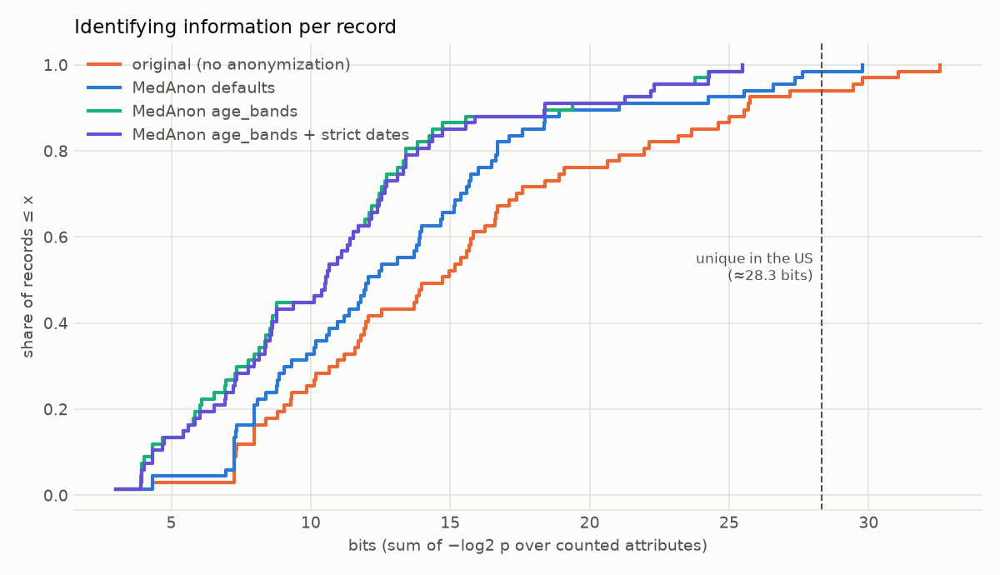
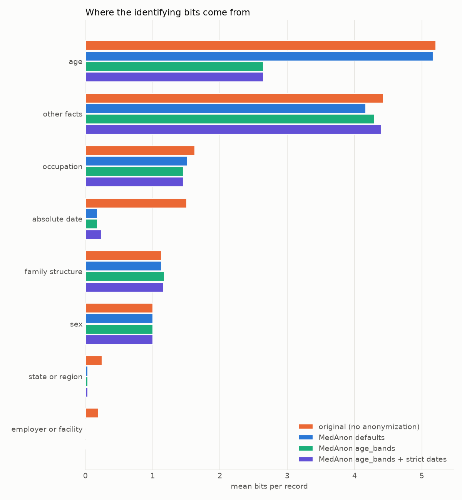
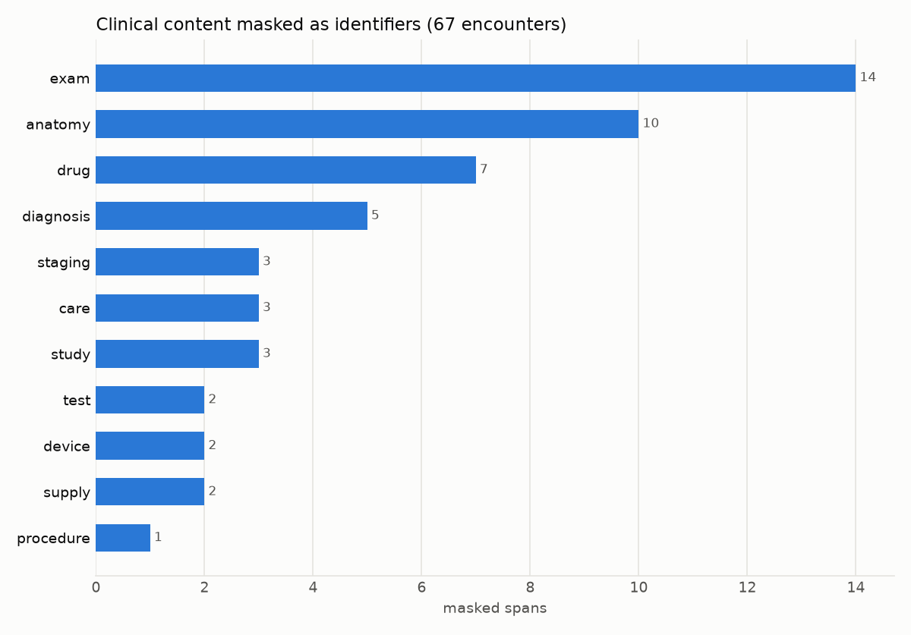

# Adversarial evaluation of MedAnon on the Neural Wave evaluation set

> Privacy note (2026-10-18): real encounter IDs are replaced by neutral labels (R1–R10, T1–T3), and record-specific names, places and verbatim quotes by paraphrases. Per-record files keyed by real IDs stay local.

*Re-identification risk, masked-value recovery and clinical over-redaction under three anonymization
policies. All numbers are regenerated from result files by `attack/paper/make_paper_assets.py`
(`tables.json`), `mask_review.py` and `attribute_review.py`; per-record values are in
`results/per_record.csv` (generated locally, not published). Date of runs: 2026-10-18.*

## Summary

We anonymized the 67 encounters of the Bosch Neural Wave evaluation split with MedAnon (commit `ceff209`,
full detector stack) under three policies. We then attacked each output with an independent LLM
adversary (`qwen3.5:35b`). The adversary extracts the patient's quasi-identifiers from the anonymized
text, prices them against US population statistics, and tries to infer what each placeholder hid.

- **Re-identification risk.** The expected probability of singling out the right person falls from
  0.063 on the original text to 0.034 with MedAnon's defaults (−51.5%) and to 0.0042 with `age_bands`
  (−93.2%). No anonymized record is unique in the US population under `age_bands` (0/67), against 4/67
  for the original text and 1/67 for the defaults. The ranking holds when the least reliable part of the
  scoring, LLM-judged rarity, is removed: `age_bands` cuts risk by 90–96% in every variant, the
  defaults by 35–52%.
- **Where the residual risk lies.** After `age_bands`, the largest remaining source of identifying
  information is idiosyncratic lifestyle facts that no anonymizer masks: an auto-repair-shop owner, an
  x-ray technician, ten siblings. They carry 4.3 bits per record on average, more than the age band
  (2.6 bits).
- **Recovery of masked values.** The adversary recovered 7 of 98 scorable masked identifiers (7.1%;
  95% CI 3.5–14.0%). Excluding names, 6 of 32 (19%; 95% CI 9–35%), each from context: a landmark gave
  the state (a named mountain → its US state), and the occupation came back from an occupational lung
  disease plus farm work, and from a passing mention of a supermarket job. Names were recovered only at chance level (2/69, common first names).
- **Residual identifiers that MedAnon missed in every policy:** two numeric dates (a day/month and a month/year)
  and one month in free text. Under `age_bands`, one adult birth year survives (`[DOB] YYYY`) in a
  record whose age is never stated.
- **Clinical over-redaction.** In a full human review, 73 of 518 masked spans (14.1%) were not
  identifiers. 52 of them were clinical content, in 25 of 67 encounters (37%): exam findings (supple,
  afebrile, pursed lips), tendons (FDS/FDP), eponymous tests and staging (a knee-ligament test,
  melanoma level and Breslow thickness), drugs (Taxol, Buspar), and diagnoses (Cushing's, hepatitis C,
  Tourette's, farmer's lung).
- **Attacker validity.** On a held-out sample, 81% of the facts the adversary counted were true,
  non-medical facts about the patient (26/32; 95% CI 65–91%). The errors inflate scores, so the risks
  above are conservative (upper-bound) estimates.

## 1. Setup

| item | value |
|---|---|
| Data | Bosch Neural Wave evaluation split: 67 doctor–patient encounters (dialogue + clinical note + ICD-10 codes), synthetic patients; `sha256 f0760f2c…` |
| Anonymizer | MedAnon `ceff209` (`code_sha256 4ff71990…` on this machine): rules + spaCy `en_core_web_lg` 3.8.0 / Presidio + `dslim/bert-base-NER-uncased` + `OpenMed-PII-SuperClinical-Large-434M`; `--offline`, 4 workers |
| Anonymizer hardware and cost | Apple M1 Pro (10 cores, 16 GB): 2.38–2.47 s per encounter, 6 s model load, 9.5–9.8 GB peak RAM including workers |
| Policies | **defaults**: exact adult ages, `[DOB] <year>`, `[DATE] <year>`. **age_bands** (`configs/age_bands.yaml`): adult ages in 10-year bands, 90+ top-coded, adult birth year dropped. **age_bands + strict dates** (`configs/age_bands_strict_dates.yaml`): additionally drops the year from full dates |
| Adversary | `qwen3.5:35b` Q4_K_M (digest `72aac7c2…`), Ollama 0.34.0 on one RTX 4090 D (48 GB); temperature 0, seed 42; context 16,384; thinking off; output capped at 4,096 tokens; prompts `extract-v4`, `recover-v4` |
| Adversary cost | ≈4.3 s per LLM call. Attacking one anonymized record (extraction + recovery) ≈8.6 s; ≈13 s including extraction of the original for scoring. The model runs one request at a time (Ollama: "architecture does not support parallel requests") |
| Completeness | 201 LLM tasks per policy; 0 failed records and 0 skipped tasks in the final runs. Runaway (repetitive) outputs occurred in 5 of the final calls and were recovered by a sampled retry |
| Reproducibility | Every response is cached by sha256(model, prompt version, prompt). The final numbers were recomputed with 0 new LLM calls |

## 2. Method

**Threat model.** A curious analyst holds one anonymized encounter and public knowledge: population
statistics and general world knowledge, here an LLM. They want to (a) single out the patient in the US
population and (b) recover masked values. They have no auxiliary identity database.

**Extraction and verification.** One schema-constrained LLM call per record returns the patient's age,
birth year, sex, state/region, city, occupation, employer/facility, ethnicity, nationality, absolute
dates, family structure and other idiosyncratic facts. Each fact comes with a verbatim evidence quote and
a rarity label. A fact is kept only if all of the following hold:
- its quote is found in the text (exact, or fuzzy-ratio ≥ 90);
- for literal fields, the value appears in its own quote;
- it is not medical content (diagnoses, drugs, procedures, symptoms; matched by a vocabulary or against
  the record's ICD descriptions);
- it does not restate an ICD external-cause or activity code (e.g. `Y93.53 Activity, golf`), because the
  task requires keeping those codes;
- it is not a person's name or a relative date.

If the LLM extracts no age, a deterministic rule reads the patient-introduction pattern ("is a 46-year-old
female"). It fired in 0–3 anonymized and 4 original records.

**Pricing.** Each kept fact gets a population share *p*:

| attribute | source of *p* |
|---|---|
| age, age band | ACS 2020 single-year shares |
| state | Census 2020 population share |
| occupation | BLS OEWS 2023 employment share |
| ethnicity | Census 2020 |
| family structure | buckets |
| common lifestyle facts | a sourced table of 38 entries (CDC, SFIA, NGF, ACS, AHS, Gallup) |
| remaining idiosyncratic facts | the LLM's rarity bucket (10⁻¹ to 10⁻⁴) |

Restatements are de-duplicated: one value per category, at most three other facts, and restated facts
merged across categories.

**Scoring.** bits = Σ −log₂ *pᵢ*; λ = (N − 1)·Π *pᵢ*, the expected number of other US residents sharing
every attribute (N = 335 M); risk = (1 − e^−λ)/λ, the probability of picking the right person among the
Poisson look-alikes. A record is *likely unique* when λ < 1, i.e. above ≈28.3 bits. The original text is
scored the same way. Each side is also credited with the other side's facts that verify in its own text,
so that privacy gain measures what the anonymizer removed rather than extraction noise.
`privacy_gain = 1 − risk_anon / risk_orig`.

**Recovery.** A second call asks for the original value behind each placeholder about the patient. The
ground truth is the original span, found by word-aligning the anonymized text with the original. Scoring:
- one guess per placeholder (the most confident);
- a guess must match the value the placeholder hid most often in that record;
- age within ±1; state and year exact; other fields fuzzy ≥ 85 after removing titles;
- placeholders outside the attack's scope (weekday, month, ID…) are unscored;
- filler placeholder names count as wrong.

Correct guesses are split by what the span really was: an identifier, or content MedAnon masked by
mistake.

**Deterministic audit** (no LLM). It scans the anonymized text with regular expressions for exact adult
ages, bare answers to "how old are you?", 4- and 2-digit birth years, and full dates with a visible year.

**Human reviews** (one annotator, the author of the adversary):
1. *Mask review.* Every placeholder whose aligned original span is not a direct identifier was read in
   context and labelled clinical, filler or other false positive (`mask_review.py`). The 265 spans behind
   name, ID and DOB placeholders were also skimmed; all were correct.
2. *Attribute review, round 1.* Every counted attribute except age and sex on the `age_bands` run was
   labelled valid, medical, ICD floor, duplicate, trivial or uncertain. Mispricing was noted separately.
   This round was used to find adversary bugs.
3. *Held-out review.* 15 training encounters (seed 2026; `results/heldout_sample.json`) were anonymized
   with `age_bands`, attacked once with the final adversary, and reviewed after all fixes. This is the
   unbiased precision estimate.

**Sensitivity.** Every metric is recomputed (a) without facts priced by the LLM's rarity bucket and
(b) with core quasi-identifiers only (age, sex, place, occupation, employer, ethnicity, dates, family).

## 3. Results

### 3.1 Re-identification risk

*Table 1. Adversary results on the 67 evaluation encounters. "Original" uses the `age_bands` comparison;
across the three comparisons the original's mean risk ranges from 0.063 to 0.072.*

| metric | original | defaults | age_bands | age_bands + strict dates |
|---|---|---|---|---|
| mean / median / p90 bits | 15.5 / 14.7 / 25.2 | 13.2 / 12.1 / 19.8 | **10.8 / 10.6 / 18.8** | 10.9 / 10.6 / 18.4 |
| mean risk | 0.063 | 0.034 | **0.0042** | 0.0045 |
| median risk | 8.1×10⁻⁵ | 1.3×10⁻⁵ | **4.5×10⁻⁶** | 4.5×10⁻⁶ |
| maximum risk | 0.96 | 0.84 | **0.14** | 0.14 |
| records with risk ≥ 10⁻³ | 18 | 10 | **8** | 8 |
| likely unique (λ < 1) | 4 (6.0%) | 1 (1.5%) | **0** | 0 |
| privacy gain | – | 51.5% | **93.2%** | 93.7% |
| bits removed per record | – | 2.2 | **4.7** | 4.7 |
| evidence not found in text | 5.0% | 3.6% | 4.6% | 4.4% |



*Figure 1. Cumulative distribution of identifying bits per record. The dashed line marks uniqueness in
the US population.*

*Table 2. Sensitivity of privacy gain to the pricing of idiosyncratic facts.*

| variant | defaults: gain / bits removed | age_bands: gain / bits removed | strict dates: gain / bits removed |
|---|---|---|---|
| full scoring | 51.5% / 2.2 | 93.2% / 4.7 | 93.7% / 4.7 |
| without LLM rarity buckets | 34.5% / 1.9 | 89.5% / 4.4 | 92.3% / 4.4 |
| core quasi-identifiers only | 42.0% / 1.9 | 96.0% / 4.4 | 96.0% / 4.4 |

The conclusion does not depend on the most subjective part of the scoring: age bands remove about
4.4–4.7 bits per record and roughly an order of magnitude of risk, while the defaults remove about 2.

### 3.2 Where the identifying bits come from



*Figure 2. Mean bits per record by attribute.*

| attribute (mean bits / record) | original (defaults comparison) | defaults | age_bands |
|---|---|---|---|
| age | 5.21 | 5.17 | **2.64** |
| other idiosyncratic facts | 4.43 | 4.17 | 4.30 |
| occupation | 1.63 | 1.52 | 1.45 |
| absolute date | 1.50 | 0.18 | 0.18 |
| family structure | 1.13 | 1.13 | 1.18 |
| sex | 1.00 | 1.00 | 1.00 |
| state / region | 0.25 | 0.03 | 0.03 |
| employer / facility | 0.20 | 0 | 0 |

MedAnon's defaults already remove almost all date, place and employer information. `age_bands` halves the
age information. What remains is mostly lifestyle and occupational detail, which no current policy
targets. These records stay riskiest under `age_bands`:

| record | risk | what the adversary scores |
|---|---|---|
| R9 | 0.14 | age band, sex, *auto repair shop owner* (1 in 1,000), unmasked biopsy date (day/month), smoker |
| R10 | 0.06 | sex, *ten siblings*, works on a farm, farm work without a mask |
| R7 | 0.04 | age band, *x-ray technician*, unmasked month, recent car accident |

### 3.3 Residual identifiers (deterministic audit, 67 encounters)

| residue in the anonymized text | defaults | age_bands | strict dates |
|---|---|---|---|
| exact adult age | 50 | **0** | 0 |
| birth year (4-digit / 2-digit) | 8 / 1 | **1 / 0** (R8 `[DOB] YYYY`, no age stated) | 1 / 0 |
| full date with visible year (`[DATE] 2021`) | 10 | 10 | **0** |
| numeric date left unmasked | 2 (`04/10`, `03/2020`) | 2 | 2 |
| month left in free text | 1 (R7) | 1 | 1 |
| bare answer to "how old are you?" | 0 | 0 | 0 |

The unmasked numeric dates were confirmed by reading every slash-number in the outputs. 29 of the 31
candidates were murmur grades, strength grades or pain scores, all correctly kept.

### 3.4 Recovery of masked values

*Table 3. Recovery results under `age_bands`, with 95% Wilson intervals. The other policies are within
the intervals.*

| what was masked | scorable | recovered | rate |
|---|---|---|---|
| all placeholders | 118 | 11 | 9.3% (5.3–15.9%) |
| real identifiers | 98 | 7 | 7.1% (3.5–14.0%) |
| real identifiers, excluding names | 32 | 6 | 18.8% (8.9–35.3%) |
| names | 69 | 2 | 2.9% (chance: common first names) |
| content masked by mistake | 20 | 4 | 20% (8–42%) |

What the adversary recovered from context:
- **State, from a landmark.** a hiking trip near a named mountain, left in clear text
  next to `[LOCATION]`, gave away `[US_STATE]` (high confidence).
- **Occupation, from the condition and the work described.** `[OCCUPATION]` = farmer, from farm work,
  unloading hay and "[OCCUPATION] lung" (farmer's lung).
- **Occupation, from the workplace.** "works in a supermarket" → cashier; "yard work, landscaping" →
  landscaper.
- **Organizations, from the activity.** A 110-lb weight loss → Weight Watchers; husband's insurance →
  Medicare.
- **Over-redacted content, from clinical context.** a knee-ligament test, Achilles, labs, a brace brand. Recovering these
  shows they were never identifying.

Held-out sample (15 training encounters, `age_bands`): 1 of 26 scorable placeholders recovered.

### 3.5 Clinical over-redaction (human mask review)

| | spans | encounters |
|---|---|---|
| placeholders aligned to an original span | 518 | 67 |
| correct masks (identifiers, names, dates, places, organizations, occupations) | 445 (85.9%) | |
| **clinical content masked** | **52 (10.0%)** | **25 (37%)** |
| filler words masked ("lem" = "let me", "mm hmm", "hey" before "dragon") | 17 | 12 |
| other non-identifying words ("cold turkey" → `[LOCATION: Middle East]`, "french fry") | 4 | 4 |



*Figure 3. Clinical content masked as identifiers, by kind.*

The masked clinical content includes:
- **Exam findings:** supple neck, afebrile, pursed-lip breathing, coarse rhonchi, normoactive bowel
  sounds, neurovascular status, lungs.
- **Anatomy:** flexor digitorum superficialis/profundus, right coronary artery.
- **Tests and staging:** a knee-ligament test, Achilles reflex, melanoma invasion level, Breslow thickness.
- **Drugs:** Taxol, Buspar, Camila.
- **Studies and devices:** MR arthrogram, autoimmune labs, Aircast.
- **Diagnoses:** Cushing's, hepatitis C, Tourette's, farmer's lung.

The pattern is identical under all three policies. A regex lower bound (`attack.audit_masks`) finds only
7 of these spans in 6 encounters, so human review was necessary.

### 3.6 Validity of the adversary

| measurement | precision of counted facts | facts | share of bits from invalid facts |
|---|---|---|---|
| Round 1, evaluation set, before fixes | 79% (72–85%) | 152 | 24% |
| Round 1 labels, after fixes (same data, optimistic) | 91% (85–95%) | 133 | 10% |
| **Held-out, after fixes** | **81% (65–91%)** | 32 | 30% |

The remaining errors are:
- medical facts the vocabulary misses (thickened nails, a medicated wash);
- garbled transcription read as a fact ("grits on face");
- restatements;
- one generic statement read as the patient's ethnicity.

In addition, 8 of the 26 valid held-out facts were mispriced, mostly everyday tastes priced as 1 in 10.
All of these errors add bits, so the adversary overstates risk. Facts the LLM did not extract are not
measured; recall was estimated only for age, through the fallback rule.

Bugs found and fixed during this evaluation, before the final numbers:
- runaway generations silently skipped recovery for 2 records per run;
- greedy retries replayed the same failure;
- facts were double counted across categories;
- extracted values that were inferred rather than stated were priced as facts;
- the recovery prompt quoted values from evaluation records (so an example could be copied);
- repeated placeholders pooled their ground truths, and duplicate guesses inflated recovery;
- the adversary had no deterministic age fallback.

## 4. Discussion

1. **Generalizing age is the single most effective policy change.** It removes about 2.5 bits per record
   and drives risk down by an order of magnitude. Its clinical cost (decade bands instead of exact
   adult ages) is the trade-off to report. Dropping the year from dates (`strict_dates`) removes 10
   visible years but changes no adversary metric. Its value depends on linkage to dated records, which
   this threat model does not include.
2. **The residual risk is long-tail.** It comes from rare lifestyle and occupational facts that are
   clinically relevant context (occupational exposure, accident mechanism) and that no rule-based policy
   removes without harming the note. They concentrate in a few records (8 of 67 above 10⁻³). The
   paper should present them as an irreducible floor for utility-preserving anonymization, together with
   diagnoses.
3. **Placeholders leak through context.** Masking the token is not enough: landmarks, eponymous diseases
   and workplaces reveal masked states and occupations. Targeted fixes are masking landmarks near
   masked places and generalizing occupation-bearing eponyms. Both are cheap.
4. **Over-redaction is a utility problem.** 37% of encounters lose clinical content, including findings
   that change interpretation (staging, tendons, diagnoses). These losses are invisible to identifier-level
   metrics, and Bosch's medical-concept-recall metric may not cover these concepts. A clinical-vocabulary
   guard on detector output would recover them at no privacy cost: the review found no identifier among
   these spans.

## 5. Limitations and threats to validity

- **Synthetic patients and population model.** Scores are expected uniqueness under US population
  statistics with an independence assumption, not real re-identification. Independence overstates risk
  for correlated attributes; de-duplication mitigates this only partly.
- **One adversary model and one annotator.** Results depend on the model's strength. The reviews were
  done by one annotator who also built the adversary, so inter-annotator agreement was not measured.
- **Small samples.** 67 encounters, 15 held out. Recovery rates and precision come with wide intervals,
  which are reported.
- **Iteration on the evaluation set.** The adversary was debugged on these 67 records. The held-out
  precision is the unbiased figure, and the main conclusions hold under the sensitivity variants that
  exclude the most tuned component.
- **Not comparable with the official Bosch scores.** The privacy-removal score (0.5918) uses different
  metrics and data.
- **Prompt content.** The extraction prompt still contains two placeholder examples from the task
  description (`[DOB] 1982`, `[LOCATION: Middle East]`). Extraction cannot copy them, because every value
  must be quoted verbatim from the record.

## 6. Reproducibility

```bash
# Mac: anonymize (MedAnon ceff209, --offline)
medanon anonymize -i data/eval_patient_doctor_encounters.jsonl -o outputs/eval_paper/eval.age_bands.jsonl \
    --config configs/age_bands.yaml --offline --workers 4          # likewise for the defaults and strict dates
# GPU host: attack (cached responses make reruns free)
python -m attack.run --input data/eval.age_bands.jsonl --original data/eval_patient_doctor_encounters.jsonl \
    --workers 1 --out attack/results/eval_paper/age_bands
# Mac: deterministic audit, human-review tallies, tables and figures
python -m attack.audit_masks --original data/eval_patient_doctor_encounters.jsonl \
    --anonymized outputs/eval_paper/eval.age_bands.jsonl --out outputs/eval_paper/eval.age_bands.audit.json
python -m attack.paper.mask_review --original data/eval_patient_doctor_encounters.jsonl \
    --anonymized outputs/eval_paper/eval.age_bands.jsonl --out attack/paper/mask_review.age_bands.json
python -m attack.paper.attribute_review attack/results/eval_paper/heldout15_age_bands/per_record.jsonl --round heldout
python -m attack.paper.make_paper_assets --runs attack/results/eval_paper --audits outputs/eval_paper
```

| file | content |
|---|---|
| `tables.json` | every number above, per policy |
| `results/per_record.csv` | bits and risk per encounter and policy, plus an over-redaction flag (local only: keyed by encounter IDs, not published) |
| `mask_review*.json`, `mask_review.py` | human labels of false-positive masks (non-identifying spans only) |
| `attribute_review.py`, `attribute_review_heldout.json`, `results/attribute_review_*.json` | human labels and precision |
| `results/heldout_sample.json` | held-out IDs and seed |
| `figures/` | Figures 1–3 |

Per-record adversary outputs with evidence quotes (`attack/results/eval_paper/`) and the anonymized files
(`outputs/eval_paper/`) stay local because they quote encounter text.
